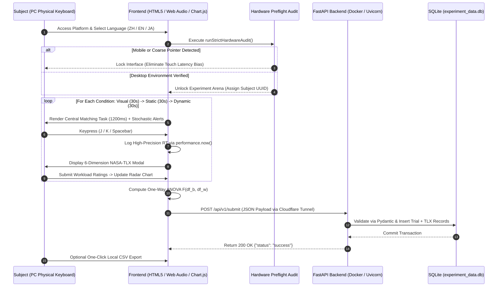

# 🔬 SonicAnalytics Lab

<div align="center">

**Multimodal Auditory Cueing & Cognitive Workload Experimental Platform (HCI Dual-Task)**  
多模態音響提示與認知負荷實驗平台 ｜ 多モーダル音響提示と認知的負荷評価プラットフォーム

[](https://fastapi.tiangolo.com/)
[](https://www.docker.com/)
[](https://developer.mozilla.org/en-US/docs/Web/API/Web_Audio_API)
[](https://www.chartjs.org/)
[](https://opensource.org/licenses/MIT)

### 🚀 [點此直接啟動線上實驗平台 (Live Demo)](https://peenlin.github.io/SonicAnalytics/)

[🇯🇵 日本語](#-日本語-japanese-documentation) | [🌐 English](#-english-documentation) | [🇹🇼 繁體中文](#-繁體中文說明文件) | [📐 Mathematical & System Specs](#-mathematical-models--system-architecture)

</div>

---

## 🇯🇵 日本語 (Japanese Documentation)

### 1. プロジェクト概要と研究背景
**SonicAnalytics Lab** は、ヒューマンコンピュータインタラクション（HCI）および実験心理物理学向けに設計された二重課題（Dual-Task）認知的負荷評価プラットフォームです。

現代の高負荷な視覚作業環境において、視覚チャネルのみに依存した情報提示は「注意の狭窄（Attentional / Cognitive Tunneling）」を引き起こし、周辺視野における緊急アラートへの反応遅延を招きます。本研究プラットフォームは、クリストファー・ウィケンズの**多元資源理論（Multiple Resource Theory: MRT）**に基づき、異なる音響提示モダリティ（純粋視覚、固定周波数ビープ音、動的周波数スイープ音）が人間の認知的負荷および周辺アラートへの反応時間（Reaction Time: RT）に与える影響を定量的・主観的の両面から検証します。

### 2. コア機能と実験設計
- **3段階自動実験プロトコル（カウンターバランス・パイプライン）**：
  - `Condition 1 (Visual Only)`：視覚単独ベースライン条件（30秒間）。
  - `Condition 2 (Static Beep)`：440 Hz 矩形波による固定音響キュー提示条件（30秒間）。
  - `Condition 3 (Dynamic Audio)`：620 Hz → 950 Hz 正弦波指数スイープ（Chirp信号）による動的音響フィードバック条件（30秒間）。
  - 各条件間に5秒間の自動インターバル（休憩カウントダウン）と主観評価フェーズを配置。
- **Web Audio API によるゼロ遅延リアルタイム音響合成**：
  外部音声ファイルの読み込みによるI/O遅延やジッターを完全に排除するため、ブラウザネイティブの `OscillatorNode` および `GainNode` を用いてプログラム的に波形とエンベロープを直接合成。
- **厳格なハードウェア環境事前検証（Ecological Preflight Validation）**：
  ミリ秒単位（`performance.now()`）の反応時間計測における内的妥当性を担保するため、User-Agent、ポインタ精度（`pointer: coarse`）、マルチタッチ点数（`maxTouchPoints > 2`）、画面幅を自動判定。モバイル端末やタッチパネル環境からのアクセスを自動的にブロックし、物理キーボード（`J` / `K` / `Space`）を備えたPC環境のみを許可します。
- **客観的・主観的指標のリアルタイム統計解析**：
  - 各試行のミリ秒精度の反応時間（Mean RT）トラッキング。
  - **NASA-TLX（6次元主観的メンタルワークロード評価）**：精神的要求、身体的要求、時間的切迫感、作業成績、努力度、フラストレーションをレーダーチャートで即時重畳可視化。
  - **一元配置分散分析（One-Way ANOVA）**：実験完了と同時に3条件間の分散分析を実行し、$F(df_b, df_w)$ 統計量を自動算出。
- **ハイブリッド・データ永続化パイプライン**：
  FastAPI + Pydantic + SQLite で構築されたバックエンドコンテナへ Cloudflare Tunnel 経由でリアルタイム送信すると同時に、ネットワーク切断時にもデータを保護するクライアントサイド CSV エクスポート機能を搭載。

---

## 🌐 English Documentation

### 1. Project Overview & Problem Statement
**SonicAnalytics Lab** is an empirical Human-Computer Interaction (HCI) and psychophysical dual-task experimental platform designed to evaluate human cognitive workload, attentional tunneling, and peripheral response latency under varying auditory display modalities.

Participants engage in a continuous **Central Visual Working Memory Task** (alphanumeric string discrimination refreshed every $1,200\text{ ms}$ via `J` [Match] / `K` [Mismatch] keys) while simultaneously responding to stochastic **Peripheral Alerts** (inter-stimulus interval $U(1500, 3500)\text{ ms}$ via `Spacebar`). The platform captures sub-millisecond behavioral telemetry, collects multi-dimensional subjective workload ratings, and computes inferential statistics on the fly.

```text
+-------------------------------------------------------------------------+
|                        HCI Dual-Task Paradigm                           |
+-------------------------------------------------------------------------+
|  [Primary Task: Central Foveal Vision]                                  |
|   Alphanumeric Working Memory Matching (1200ms cycle) -> Keys [J] / [K] |
|                                                                         |
|  [Secondary Task: Peripheral Situational Awareness]                     |
|   Stochastic Alert (1500~3500ms ISI) -> Visual Flash + Auditory Cue     |
|     ├── Condition 1: Visual Only (Baseline)                             |
|     ├── Condition 2: 440 Hz Square-Wave Static Beep                     |
|     └── Condition 3: 620 Hz -> 950 Hz Sine Sweep Dynamic Cue            |
|   User Response -> Key [Spacebar] -> Δt logged via performance.now()    |
+-------------------------------------------------------------------------+
                                    │
                                    ▼
+-------------------------------------------------------------------------+
|                 Real-Time Psychometric & Statistical Engine             |
+-------------------------------------------------------------------------+
|  • Objective Telemetry : Mean Reaction Time (ms) & Trial Timestamping   |
|  • Subjective Workload : 6-Factor NASA-TLX Overlaid Radar Chart         |
|  • Inferential Stats   : Client-Side One-Way ANOVA F(df_b, df_w)        |
|  • Data Persistence    : FastAPI + Pydantic + SQLite (Docker) & CSV     |
+-------------------------------------------------------------------------+
```

### 2. Key Technical Capabilities
- **Three-Condition Automated Protocol**: Seamless state-machine transitions across Visual Baseline (30s), Static Auditory Cueing (30s), and Dynamic Spectrally Modulated Cueing (30s), interleaved with NASA-TLX assessment modals and 5-second recovery periods.
- **Zero-Latency Programmatic Sound Synthesis**: Native Web Audio API (`AudioContext`) synthesizes waveforms directly in memory without external asset fetching delays.
- **Hardware & Input Latency Gatekeeper**: Automated multi-heuristic preflight audit blocks touchscreen/mobile devices to eliminate capacitive touch latency bias.
- **Client-Side Inferential Statistics & Visualization**: Real-time Chart.js radar rendering and automatic One-Way Analysis of Variance (ANOVA) computation across experimental blocks.
- **Resilient Full-Stack Telemetry Pipeline**: Headless ingestion via FastAPI (`/api/v1/submit`), schema-enforced with Pydantic, stored in SQLite (`experiment_data.db`), and containerized via Docker on a private node.

---

## 🇹🇼 繁體中文說明文件

### 1. 專案簡介與研究動機
**SonicAnalytics Lab** 是一套專為人機互動（HCI）與實驗心理物理學打造的雙任務（Dual-Task）認知負荷評估平台。本系統旨在探討於高心智負荷作業情境下，不同音響提示模態（純視覺、固定頻率蜂鳴、動態頻率調變音）對使用者「注意力窄化（Cognitive Tunneling）」與「周邊警報反應時間（Reaction Time）」之影響。

受試者須持續執行**中央視覺工作記憶比對任務**（每 $1,200\text{ ms}$ 更新四位元英數代碼，以 `J` 鍵判定相符、`K` 鍵判定不符），同時對隨機出現的**周邊視覺與聽覺複合警報**（隨機間隔 $1,500 \sim 3,500\text{ ms}$）按下 `Space` 空白鍵進行反應。

### 2. 核心系統特性
- **三階段標準化自動實驗流程**：
  1. `純視覺基準組 (Visual Only, 30s)`：僅依靠右上角紅色視覺閃光提示。
  2. `固定逼逼聲組 (Static Beep, 30s)`：視覺閃光同步搭配 $440\text{ Hz}$ 方波固定頻率蜂鳴。
  3. `動態音響提示組 (Dynamic Audio, 30s)`：視覺閃光同步搭配 $620\text{ Hz} \to 950\text{ Hz}$ 動態正弦掃頻提示音。
- **Web Audio API 原生零延遲音訊合成**：利用瀏覽器底層振盪器（`OscillatorNode`）與增益節點（`GainNode`）實時合成音效包絡線，免除外部音訊檔案載入延遲，確保毫秒級實驗內部效度。
- **嚴格環境硬體偵測鎖定**：自動分析 `User-Agent`、指針精度（`pointer: coarse`）、多點觸控數量與視窗尺寸，強制阻絕手機與平板裝置，確保所有受試者皆使用實體鍵盤（PC / Mac）進行毫秒級響應測試。
- **即時認知指標與統計運算**：
  - 採用高精度時間戳記 `performance.now()` 追蹤每次刺激與反應之毫秒差（RT）。
  - 內建多語系 **NASA-TLX 主觀心智負荷量表**（精神需求、身體需求、時間急迫、自我績效、努力程度、挫折感），即時繪製三條件疊合雷達圖。
  - 實驗結束瞬間於前端自動完成**單因子變異數分析（One-Way ANOVA）**，輸出 $F$ 檢定統計量。
- **高容錯混合雲端資料管線**：透過 Cloudflare Tunnel 串接自建之 Docker 容器化 FastAPI 後端與 SQLite 資料庫，並提供個人化 CSV 原始資料一鍵匯出備份。

---

## 📐 Mathematical Models & System Architecture

### 1. Programmatic Acoustic Synthesis Specifications
To prevent acoustic startle reflexes while maximizing perceptual salience in Condition 3, the Web Audio API synthesis engine shapes the waveform frequency $f(t)$ and amplitude gain $G(t)$ as follows:

- **Condition 2 — Static Square-Wave Cue ($t \in [t_0, t_0 + 0.15\text{ s}]$):**

$$f_{\text{static}}(t) = 440\text{ Hz}, \quad G_{\text{static}}(t) = 0.20 \times \left(\frac{0.01}{0.20}\right)^{\frac{t - t_0}{0.15}}$$

- **Condition 3 — Dynamic Frequency-Modulated Sine Sweep ($t \in [t_0, t_0 + 0.14\text{ s}]$):**
  An upward exponential frequency chirp from $620\text{ Hz}$ to $950\text{ Hz}$ over $80\text{ ms}$ with a smoothed attack-decay envelope to eliminate click artifacts:

$$f_{\text{dynamic}}(t) = 620 \times \left(\frac{950}{620}\right)^{\min\left(1, \frac{t - t_0}{0.08}\right)}\text{ Hz}$$

$$G_{\text{dynamic}}(t) = \left\{ \begin{array}{ll} 0.001 + \frac{0.25 - 0.001}{0.015}(t - t_0), & \text{if } 0 \le t - t_0 < 0.015\text{ s (Linear Attack)} \\ 0.25 \times \left(\frac{0.01}{0.25}\right)^{\frac{t - t_0 - 0.015}{0.125}}, & \text{if } 0.015 \le t - t_0 \le 0.14\text{ s (Exponential Decay)} \end{array} \right.$$

---

### 2. Real-Time One-Way ANOVA ($F$-Test) Formulation
For each completed experimental session across $k = 3$ conditions ($\text{Visual}, \text{Static}, \text{Dynamic}$) with condition trial counts $n_i$ and total trials $N = \sum_{i=1}^{k} n_i$:

1. **Reaction Time per Trial ($RT_{ij}$):**

$$RT_{ij} = \text{round}\left(t_{\text{response}, ij} - t_{\text{stimulus}, ij}\right)\text{ [ms]}$$

2. **Between-Group Sum of Squares ($SS_B$) & Degrees of Freedom ($df_B$):**

$$SS_B = \sum_{i=1}^{k} n_i \left(\bar{RT}_i - \overline{RT}_{\text{grand}}\right)^2, \quad df_B = k - 1 = 2$$

3. **Within-Group Sum of Squares ($SS_W$) & Degrees of Freedom ($df_W$):**

$$SS_W = \sum_{i=1}^{k} \sum_{j=1}^{n_i} \left(RT_{ij} - \bar{RT}_i\right)^2, \quad df_W = N - k = N - 3$$

4. **Mean Squares & $F$-Ratio:**

$$MS_B = \frac{SS_B}{df_B}, \quad MS_W = \frac{SS_W}{df_W}, \quad F(2, N-3) = \frac{MS_B}{MS_W}$$

---

### 3. System Architecture & Data Pipeline



---

### 4. 檔案結構与部署指南 (Repository Structure & Deployment)

```text
SonicAnalytics-Lab/
├── index.html          # 前端核心：整合多語系 i18n、硬體預檢、Web Audio 合成、NASA-TLX 雷達圖與 ANOVA 運算
├── main.py             # 後端核心：FastAPI 跨域資料接收伺服器、Pydantic 資料模型驗證與 SQLite 寫入邏輯
├── Dockerfile          # 容器配置：基於 python:3.11-slim 之輕量化後端微服務封裝
├── .gitignore          # Git 忽略規則配置
└── README.md           # 專案學術規格與系統技術文件
```

#### A. 前端快速啟動 (Frontend Execution)
本專案前端為零外部建置依賴（Zero-build）之原生高パフォーマンス架構，可直接透過 GitHub Pages 線上執行，或於本地直接開啟：

```bash
# 複製儲存庫
git clone [https://github.com/PeEnLin/SonicAnalytics.git](https://github.com/PeEnLin/SonicAnalytics.git)
cd SonicAnalytics

# 直接以瀏覽器開啟，或使用 Python 啟動本地靜態伺服器
python3 -m http.server 8080
# 瀏覽器訪問 http://localhost:8080
```

#### B. 後端 Docker 容器化部署 (Backend Docker Deployment)
後端 API 伺服器採用 FastAPI 與 SQLite，可透過 Docker 一鍵建置並部署於本地伺服器或 NAS 節點：

```bash
# 1. 建置 Docker 映像檔
docker build -t sonicanalytics-backend .

# 2. 啟動容器並掛載本地資料庫持久化路徑
docker run -d \
  --name sonicanalytics-api \
  -p 8000:8000 \
  -v $(pwd)/experiment_data.db:/app/experiment_data.db \
  sonicanalytics-backend

# 3. 驗證伺服器健康狀態
curl http://localhost:8000/api/v1/health
# 預期回傳: {"status":"online","server":"Asustor Private Node"}
```

---

## 🔗 関連研究プロジェクト (Related Research Ecosystem)

- **[HCI-Interaction-Secondary-Channel](https://github.com/PeEnLin/HCI-Interaction-Secondary-Channel)**: 頭部マイクロポーズとバイノーラル立体音響フィードバックを用いた非接触型二次チャネル意図推定インタフェース。
- **[BilingualSync](https://github.com/PeEnLin/BilingualSync)**: 音響信号処理およびマルチトラック時間軸同期システム。

---

## 👤 Author / 開発者

- **Pei-En Lin (林 沛恩 / リン・ハイオン)**
- **Education**: B.A. in Music & Computer Science Implementation, National Tsing Hua University (国立清華大学)
- **Research Interests**: Auditory Display, Multimodal Human-Computer Interaction (HCI), Cognitive Ergonomics, Audio Signal Processing