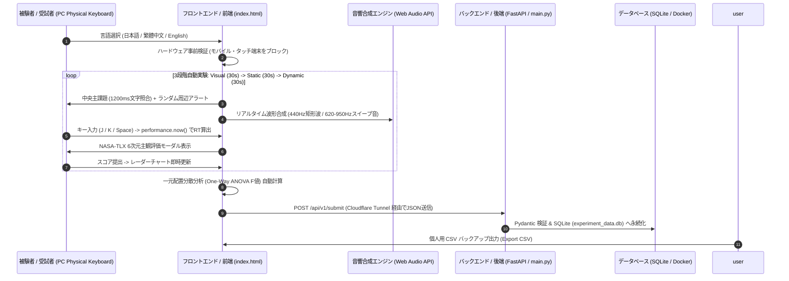

# 🔬 SonicAnalytics Lab

<div align="center">

**Multimodal Auditory Cueing & Cognitive Workload Experimental Platform (HCI Dual-Task)**  
多モーダル音響提示と認知的負荷評価プラットフォーム ｜ 多模態音響提示與認知負荷實驗平台

[](https://fastapi.tiangolo.com/)
[](https://www.docker.com/)
[](https://developer.mozilla.org/en-US/docs/Web/API/Web_Audio_API)
[](https://www.chartjs.org/)
[](https://opensource.org/licenses/MIT)

### 🚀 [點此直接啟動線上實驗平台 / Live Demo / オンライン実験デモを起動](https://peenlin.github.io/SonicAnalytics/)

[**🇯🇵 日本語ドキュメント**](#-日本語ドキュメント-japanese) ｜ [**🇹🇼 繁體中文完整說明（含原理解析）**](#-繁體中文完整說明-traditional-chinese) ｜ [**🌐 English Documentation**](#-english-documentation) ｜ [**🛠️ 系統架構與部署 (Architecture & Deploy)**](#-system-architecture--deployment--システム構成とデプロイ--系統架構與部署)

</div>

---

## 🇯🇵 日本語ドキュメント (Japanese)

### 1. プロジェクト概要と研究背景
**SonicAnalytics Lab** は、ヒューマンコンピュータインタラクション（HCI）および実験心理物理学向けに設計された二重課題（Dual-Task）認知的負荷評価プラットフォームです。

高負荷な視覚作業環境において、視覚情報のみに依存したインターフェースは「注意の狭窄（Cognitive Tunneling）」を引き起こし、周辺視野における緊急アラートへの反応遅延を招きます。本システムは、ウィケンズの**多元資源理論（Multiple Resource Theory: MRT）**に基づき、異なる音響提示モダリティ（視覚単独、固定ビープ音、動的周波数スイープ音）が人間の認知的負荷および周辺アラートへの反応時間（Reaction Time: RT）に与える影響を定量的・主観的の両面から検証します。

### 2. 実験条件と音響設計（3段階自動プロトコル）
被験者は、画面中央の**主課題（視覚ワーキングメモリ照合：1,200ms周期で更新される4桁コードの一致・不一致を `J` / `K` キーで判定）**を継続しながら、ランダムな間隔（1,500〜3,500ms）で発生する**副課題（周辺アラートに対する `Space` キー押下）**に反応します。

| 実験条件 (Condition) | テスト時間 | 視覚提示 (Visual) | 音響提示パラメータ (Web Audio API 合成) | 設計意図・心理音響的役割 |
| :--- | :---: | :---: | :--- | :--- |
| **1. Visual Only**<br>(視覚単独条件) | 30秒 | 右上赤色LED点滅 | なし（無音） | 視覚チャネル飽和時のベースライン反応時間および認知負荷の測定。 |
| **2. Static Beep**<br>(固定ビープ音条件) | 30秒 | 右上赤色LED点滅 | **440 Hz 矩形波 (Square Wave)**<br>持続時間: 150 ms / 指数減衰エンベロープ | 従来の単調な警告音の模倣。聴覚による反応促進効果と音響的疲労（不快感）の検証。 |
| **3. Dynamic Audio**<br>(動的音響提示条件) | 30秒 | 右上赤色LED点滅 | **620 Hz → 950 Hz 正弦波スイープ (Sine Chirp)**<br>持続時間: 140 ms (15ms Attack + 125ms Decay) | 上昇音程による直感的な注意喚起と、滑らかなエンベロープによるクリックノイズ・不快感の低減。 |

### 3. コアアルゴリズムと数理モデル（実装原理）

#### ① Web Audio API によるゼロ遅延音響合成
外部音声ファイルの読み込み遅延（I/O ジッター）を排除するため、ブラウザの `AudioContext` を用いてメモリ上で直接波形と音量エンベロープ（ADSR）を合成しています。
- **Condition 2（固定音）**: 標準ピッチ $f = 440\text{ Hz}$ の矩形波を生成し、音量ゲイン $G(t)$ を $0.20$ から $0.01$ へ $150\text{ ms}$ かけて指数減衰させます。
- **Condition 3（動的スイープ音）**: 周波数 $f(t)$ を $80\text{ ms}$ で $620\text{ Hz}$ から $950\text{ Hz}$ へ指数的に上昇させます。同時に、発音開始時のクリックノイズ（ポップ音）を防ぐため、最初の $15\text{ ms}$ で線形フェードイン（Linear Attack）を行い、その後 $140\text{ ms}$ にかけて指数フェードアウト（Exponential Decay）を適用しています。

$$f_{\text{dynamic}}(t) = 620 \times \left(\frac{950}{620}\right)^{\min\left(1, \frac{t}{0.08}\right)}\text{ [Hz]}$$

#### ② ハードウェア環境事前検証（Ecological Preflight Validation）
ミリ秒単位の反応時間計測の精度を担保するため、実験開始前に以下の条件を自動判定し、スマートフォンやタブレット（タッチパネル遅延）からのアクセスをブロックします：
1. `User-Agent` にモバイル端末識別子が含まれないこと。
2. ポインタ精度が粗くないこと（`pointer: coarse` かつマルチタッチ `maxTouchPoints > 2` でないこと）。
3. 画面幅が `768px` 以上であり、物理キーボード（PC / Mac）環境であること。

#### ③ 反応時間（RT）計測と一元配置分散分析（One-Way ANOVA）
- **反応時間（RT）**: 高精度タイムスタンプ `performance.now()` を用い、アラート提示時刻 $t_{\text{stimulus}}$ からスペースキー押下時刻 $t_{\text{response}}$ までの差分をミリ秒単位で算出します。

$$RT = \text{round}(t_{\text{response}} - t_{\text{stimulus}})\text{ [ms]}$$

- **一元配置分散分析（ANOVA $F$検定）**: 3つの条件（$k=3$）間の平均反応時間の差が、単なる偶然（個人の試行ごとのばらつき）ではなく「音響提示の違いによる有意な効果」であるかを検証するため、群間平方和（$SS_B$）と群内平方和（$SS_W$）から $F$ 値をリアルタイム算出します。

$$F(df_b, df_w) = \frac{MS_B}{MS_W} = \frac{SS_B / (k - 1)}{SS_W / (N - k)} \quad (\text{※ } F \text{値が大きいほど条件間の差が顕著})$$

#### ④ NASA-TLX 主観的認知負荷評価
各30秒のブロック終了直後に、6つの次元（精神的要求、身体的要求、時間的切迫感、作業成績、努力度、フラストレーション）を 0〜100 のスケールで評価し、Chart.js レーダーチャートに3条件を重畳描画します。

---

## 🇹🇼 繁體中文完整說明 (Traditional Chinese)

### 1. 專案簡介與研究動機
**SonicAnalytics Lab** 是一套專為人機互動（HCI）與實驗心理物理學打造的雙任務（Dual-Task）認知負荷評估平台。

在高心智負荷的視覺作業環境中，單純依賴視覺提示容易導致使用者產生「注意力窄化（Cognitive Tunneling）」，進而漏看或延遲反應周邊的緊急警報。本平台基於 Christopher Wickens 的**多元資源理論（Multiple Resource Theory, MRT）**，探討將周邊警報分流至聽覺通道時，不同聲學特徵（純視覺、固定頻率方波、動態上行正弦掃頻）對人類反應時間（Reaction Time）與主觀心智負荷（NASA-TLX）之具體影響。

### 2. 實驗流程與聲學條件對照表（三階段自動管線）
受試者必須維持中央視野的**主任務（視覺工作記憶比對：每 1,200ms 更新四位元英數代碼，按 `J` 鍵代表相符、`K` 鍵代表不符）**，同時對隨機出現（間隔 1,500～3,500ms）的**次要任務（右上角周邊警報，按下 `Space` 空白鍵）**做出反應。

| 實驗條件 (Condition) | 測試時間 | 視覺提示 (Visual) | 音訊合成參數 (Web Audio API 原生合成) | 聲學設計動機與預期效益（面談核心重點） |
| :--- | :---: | :---: | :--- | :--- |
| **1. 純視覺基準組**<br>(Visual Only) | 30秒 | 右上角紅燈閃爍 | 無（靜音） | 作為控制組基準（Baseline），測量純視覺高負荷下之注意力窄化與反應延遲。 |
| **2. 固定逼逼聲組**<br>(Static Beep) | 30秒 | 右上角紅燈閃爍 | **440 Hz 方波 (Square Wave)**<br>長度: 150 ms / 音量指數淡出 | 模擬傳統工業/醫療設備的單調蜂鳴警報（採用音樂標準音 A4 = 440Hz），雖然能縮短反應時間，但方波諧波較刺耳，易增加煩躁感。 |
| **3. 動態音響提示組**<br>(Dynamic Audio) | 30秒 | 右上角紅燈閃爍 | **620 Hz → 950 Hz 正弦波上行掃頻**<br>長度: 140 ms (含 15ms 淡入與 125ms 淡出) | 利用純淨的正弦波搭配「上行音高滑音（Chirp）」，直覺喚起大腦聽覺注意；並透過 Attack/Decay 包絡線消除數位爆音，兼顧低延遲與低挫折感。 |

### 3. 核心原理解析與公式白話說明（個人複習與面談指南）

#### ① 為什麼不用 MP3 音檔，而是用 Web Audio API 寫程式合成聲音？
如果載入外部 `.mp3` 或 `.wav` 檔案，瀏覽器會有網路讀取與解碼延遲（I/O Latency），這會破壞「毫秒級反應時間實驗」的準確度。因此本系統直接在記憶體中透過振盪器（`OscillatorNode`）與音量節點（`GainNode`）即時算出聲波：
- **固定音（Condition 2）**：直接產生 $440\text{ Hz}$ 方波，音量從 $0.20$ 在 $0.15\text{ 秒}$ 內平滑降到 $0.01$。
- **動態音（Condition 3）**：頻率在 $0.08\text{ 秒}$ 內從 $620\text{ Hz}$ 指數滑升至 $950\text{ Hz}$。為了防止聲音突然出現時喇叭產生「啵」的突波爆音（Click Artifact），前 $0.015\text{ 秒}$ 設計了線性淡入（Attack，音量從 $0.001$ 升至 $0.25$），隨後在 $0.14\text{ 秒}$ 內指數淡出（Decay）至 $0.01$。

$$f_{\text{dynamic}}(t) = 620 \times \left(\frac{950}{620}\right)^{\min\left(1, \frac{t}{0.08}\right)}\text{ [Hz]} \quad \text{（白話：在 0.08 秒內從 620Hz 滑音升到 950Hz）}$$

#### ② 為什麼一進網頁要先做「硬體環境檢測」？
手機與平板的觸控螢幕具有較高的硬體輸入延遲（Touch Latency），且沒有實體鍵盤可以盲按 `J`、`K` 與 `Space`。為了確保科學實驗的「內部效度（Internal Validity）」，系統在啟動前會自動檢查瀏覽器特徵（是否為手機 UA、是否為粗略觸控指標 `pointer: coarse`、視窗是否窄於 `768px`），只要判定為行動裝置便會強制鎖定，確保所有數據皆來自電腦實體鍵盤。

#### ③ 反應時間（RT）與單因子變異數分析（One-Way ANOVA）是怎麼算的？
- **單次反應時間（RT）**：就是單純的減法！當警報出現時記錄高精度時間點 $t_{\text{stimulus}}$，按下空白鍵時記錄 $t_{\text{response}}$，兩者相減即為毫秒反應時間：

$$RT = \text{round}(t_{\text{response}} - t_{\text{stimulus}})\text{ [ms]}$$

- **單因子變異數分析（ANOVA $F$-Test）**：
  做完三階段實驗後，我們怎麼證明「有聲音提示真的比純視覺快」，而不是受試者剛好運氣好按比較快？
  ANOVA 的原理就是把**「三個條件之間的平均差異（組間變異 $MS_B$）」**除以**「受試者自己每次按空白鍵的隨機不穩定度（組內變異 $MS_W$）」**：

$$F(df_b, df_w) = \frac{MS_B\text{（不同條件間的差異）}}{MS_W\text{（個人手抖的隨機誤差）}} = \frac{SS_B / (k - 1)}{SS_W / (N - k)}$$

  - 其中 $k = 3$（三個實驗條件），所以分子自由度 $df_b = 3 - 1 = 2$；$N$ 為總共按空白鍵的總次數，分母自由度 $df_w = N - 3$。
  - **結論判讀**：當算出來的 **$F$ 值越大**，就代表「聲音提示帶來的改善效果，遠大於個人隨機誤差」，證明多模態聽覺反饋在統計上具有顯著效果！

#### ④ NASA-TLX 主觀心智負荷雷達圖
除了客觀的反應時間（越快越好），HCI 研究也非常重視「使用者主觀感受」。每階段 30 秒結束後，系統會彈出國際標準的 **NASA-TLX 量表**，讓受試者評估 6 個維度（精神需求、身體需求、時間急迫感、自我績效、努力程度、挫折與煩躁感），並即時疊合在六角雷達圖上，直觀呈現「動態音響組（藍色）」如何在維持高反應速度的同時，降低受試者的挫折與精神負荷。

---

## 🌐 English Documentation

### 1. Project Overview & Problem Statement
**SonicAnalytics Lab** is an empirical Human-Computer Interaction (HCI) and psychophysical dual-task experimental platform designed to evaluate human cognitive workload, attentional tunneling, and peripheral response latency under varying auditory display modalities.

Based on Christopher Wickens' **Multiple Resource Theory (MRT)**, continuous visual working memory tasks saturate central foveal vision, inducing attentional tunneling and delayed detection of peripheral visual alerts. This platform quantifies how offloading peripheral alerts to the auditory channel—comparing static square-wave tones against dynamic frequency-swept cues—improves reaction time (RT) and modulates subjective mental workload (NASA-TLX).

### 2. Experimental Protocol & Acoustic Conditions
Participants continuously perform a **Central Visual Working Memory Task** (alphanumeric string matching updated every $1,200\text{ ms}$ using `J` [Match] / `K` [Mismatch] keys) while reacting to stochastic **Peripheral Alerts** (inter-stimulus interval $1,500 \sim 3,500\text{ ms}$ via `Spacebar`).

| Condition | Duration | Visual Stimulus | Programmatic Audio Stimulus (Web Audio API) | Ergonomic & Psychoacoustic Rationale |
| :--- | :---: | :---: | :--- | :--- |
| **1. Visual Only**<br>(Baseline) | 30s | Top-right red strobe | Mute (Silent) | Establishes baseline reaction latency and attentional tunneling under pure visual load. |
| **2. Static Beep**<br>(Monotonic Cue) | 30s | Top-right red strobe | **440 Hz Square Wave**<br>Duration: 150 ms / Exponential decay | Simulates traditional monotonic alarms (concert pitch A4). Reduces RT but rich odd harmonics may elevate acoustic annoyance. |
| **3. Dynamic Audio**<br>(Swept Chirp Cue) | 30s | Top-right red strobe | **620 Hz → 950 Hz Sine Sweep**<br>Duration: 140 ms (15ms Attack + 125ms Decay) | Upward frequency modulation captures auditory attention rapidly while smooth sine envelope minimizes startle and frustration. |

### 3. Mathematical Formulation & Core Mechanisms

#### ① Zero-Latency Sound Synthesis
To eliminate file I/O loading jitter, acoustic stimuli are synthesized directly in memory via `AudioContext`:
- **Static Mode**: Generates a $440\text{ Hz}$ square wave with gain ramping exponentially from $0.20$ to $0.01$ over $150\text{ ms}$.
- **Dynamic Mode**: Sweeps a sine wave exponentially from $620\text{ Hz}$ to $950\text{ Hz}$ over $80\text{ ms}$, shaped by a $15\text{ ms}$ linear attack ($0.001 \to 0.25$) and a $125\text{ ms}$ exponential decay ($\to 0.01$) to prevent click artifacts:

$$f_{\text{dynamic}}(t) = 620 \times \left(\frac{950}{620}\right)^{\min\left(1, \frac{t}{0.08}\right)}\text{ [Hz]}$$

#### ② Ecological Preflight Hardware Audit
To guarantee millisecond internal validity, `runStrictHardwareAudit()` inspects `navigator.userAgent`, pointer precision (`pointer: coarse`), multi-touch points (`maxTouchPoints > 2`), and viewport width (`< 768px`), locking out mobile/touchscreen devices and enforcing desktop physical keyboards.

#### ③ Reaction Time & Client-Side One-Way ANOVA
- **Reaction Time ($RT$)**: Measured via `performance.now()` delta between stimulus onset and spacebar keydown:

$$RT = \text{round}(t_{\text{response}} - t_{\text{stimulus}})\text{ [ms]}$$

- **One-Way ANOVA ($F$-Test)**: Automatically computes the ratio of Between-Group Mean Square ($MS_B$, across $k=3$ conditions) to Within-Group Mean Square ($MS_W$, across $N$ total trials):

$$F(2, N-3) = \frac{MS_B}{MS_W} = \frac{SS_B / 2}{SS_W / (N - 3)}$$

---

## 🛠️ System Architecture & Deployment / システム構成とデプロイ / 系統架構與部署

### 1. 系統互動序列圖 (System Sequence Diagram)



### 2. 檔案結構對照表 (Repository File Structure)

| 檔案名稱 (File) | 🇯🇵 日本語での役割説明 | 🇹🇼 繁體中文功能說明 | 🌐 English Description |
| :--- | :--- | :--- | :--- |
| **`index.html`** | フロントエンド本体（多言語対応、ハードウェア検証、Web Audio合成、NASA-TLX、ANOVA計算） | 前端核心單頁應用（含三語切換、硬體預檢、音訊合成、雷達圖與 ANOVA 統計運算） | Core frontend SPA (i18n, hardware audit, Web Audio synth, Chart.js radar, ANOVA engine) |
| **`main.py`** | FastAPI バックエンド（CORS設定、Pydanticデータ検証、SQLite保存API） | 後端伺服器（提供 `/api/v1/submit` 接收實驗數據、Pydantic 格式驗證與 SQLite 寫入） | FastAPI backend server with CORS, Pydantic schema validation, and SQLite ingestion |
| **`Dockerfile`** | `python:3.11-slim` ベースの軽量バックエンドコンテナ構成ファイル | 基於 `python:3.11-slim` 的輕量化 Docker 容器封裝配置檔 | Lightweight container image specification based on `python:3.11-slim` |
| **`README.md`** | プロジェクト仕様書・実験設計および数理モデル解説 | 專案三語完整規格書、實驗設計與數學原理解析 | Comprehensive trilingual documentation and system specifications |

### 3. 本地與容器化啟動指南 (Quick Start & Docker Deployment)

#### A. 前端直接啟動 (Frontend Execution / フロントエンド起動)
```bash
# Clone repository / リポジトリのクローン / 複製專案
git clone [https://github.com/PeEnLin/SonicAnalytics.git](https://github.com/PeEnLin/SonicAnalytics.git)
cd SonicAnalytics

# Run local static server / ローカルサーバー起動 / 啟動本地靜態伺服器
python3 -m http.server 8080
# Open http://localhost:8080 in Desktop Browser
```

#### B. 後端 Docker 部署 (Backend Container / バックエンドDocker起動)
```bash
# Build image / イメージビルド / 建置映像檔
docker build -t sonicanalytics-backend .

# Run container with persistent SQLite volume / コンテナ起動 / 啟動容器並掛載資料庫
docker run -d \
  --name sonicanalytics-api \
  -p 8000:8000 \
  -v $(pwd)/experiment_data.db:/app/experiment_data.db \
  sonicanalytics-backend

# Health check / 稼働確認 / 狀態檢查
curl http://localhost:8000/api/v1/health
```

---

## 🔗 関連研究プロジェクト / 相關研究生態系 / Related Projects

- **[HCI-Interaction-Secondary-Channel](https://github.com/PeEnLin/HCI-Interaction-Secondary-Channel)**: 頭部マイクロポーズとバイノーラル立体音響（左440Hz / 右880Hz）を用いた非接触型二次チャネル意図推定インタフェース（次要通道免接觸式頭部姿態與雙耳空間音訊互動介面）。
- **[BilingualSync](https://github.com/PeEnLin/BilingualSync)**: 音響信号処理およびマルチトラック時間軸同期システム（音訊訊號處理與多軌時間軸同步系統）。

---

## 👤 Author / 開発者 / 開發者

- **Pei-En Lin (林 沛恩 / リン・ハイオン)**
- **Background**: National Tsing Hua University (国立清華大学 音楽学系卒 / 情報工学実装)
- **Research Interests**: Auditory Display, Multimodal HCI, Cognitive Ergonomics, Psychoacoustics